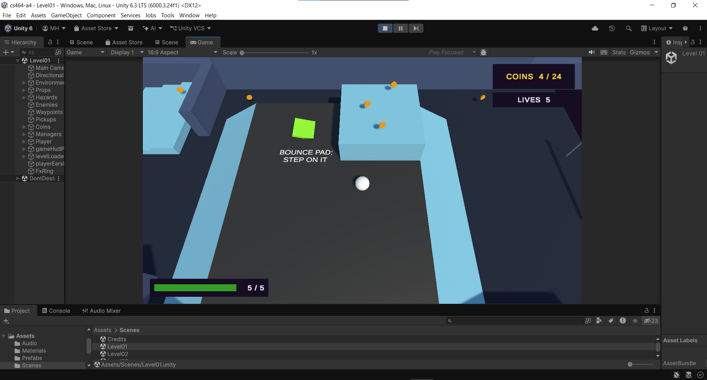
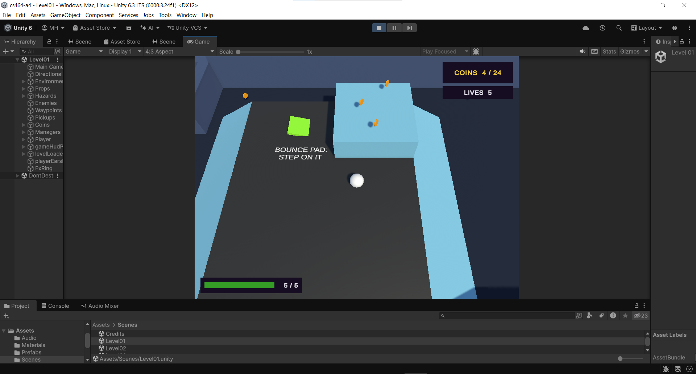
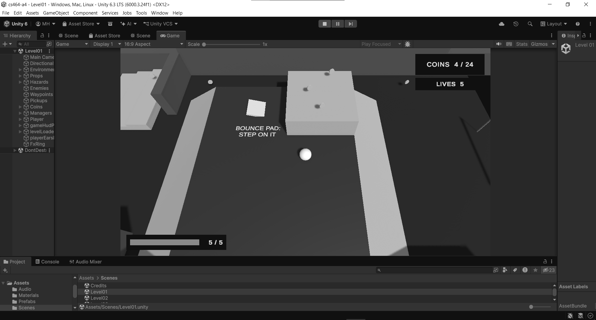

# CS464 Assignment 04 · Muhammad Hamza · BSSE23001

**Video:** https://drive.google.com/file/d/1-CtwnZGskiyIDmn3EH4E0jbZpNK7_twq/view?usp=sharing

## Settings

| Part | Setting                      | Value                                           | Why                                                                   |
| ---- | ---------------------------- | ----------------------------------------------- | --------------------------------------------------------------------- |
| A    | Harmony · base hue           | split-complementary · 262°                      | violet base; amber (52°) and green (112°) either side of its opposite |
| A    | Dark · mid · light           | #150E20 · #9E7ADC · #F3EEFC                     | three clear grey steps: 17, 137, 240                                  |
| A    | Accents                      | #FFD83D · #359D25                               | amber = score and the selected button; green = health                 |
| A    | Score text on its panel      | 13.57 : 1                                       | solid panel, not the level                                            |
| A    | Button label on the button   | 5.62 : 1                                        | a dark label; white would be 2.65 : 1                                 |
| B    | Music · SFX groups, as mixed | −6.0 dB · 0.0 dB                                | music sits under the effects                                          |
| B    | Slider at 1 · 0.5 · 0.0001   | 0 dB · −6.02 dB · −80 dB                        | dB = Log10(v) × 20; the minimum avoids Log10(0)                       |
| C    | Goal beacon, in Level 1      | Logarithmic · Min 4 · Max 50                    | a homing cue that swells near the goal                                |
| C    | Guard hum, in Level 3        | Linear · Min 2 · Max 16                         | silent when no guard is near; warns before the 6 m chase              |
| C    | AudioListener                | on `playerEarsPrefab`, which follows the player | camera is ~18 m from the ball                                         |
| D    | unlocked                     | int · default 1                                 |                                                                       |
| D    | best1 … best5                | float · HasKey first                            |                                                                       |
| D    | musicVolume (and sfxVolume)  | float · default 0.5 (1)                         |                                                                       |

## Answers

1. **What `Time.timeScale = 0` stops in my game, and what it doesn't:** It freezes everything that is running on the scaled time like physics engine, the clock, the respawn timer. It doesn't stop `Update`, or anything running on unscaled time like the panel pop-in, the loading bar etc. It doesn't stop audio either, which is why pausing also sets `AudioListener.pause`; the music and menu clicks simply ignore it.

2. **What survives a LoadScene in my game, and how:** `SfxPlayer` and `PersistentMusic` survive through `DontDestroyOnLoad`, with a singleton check so a later copy destroys itself. Unlocks, best times and volumes are in PlayerPrefs saved on the disk. `Time.timeScale`, `AudioListener.pause` and `PauseMenu.IsPaused` survive as statics, so `Resume()` and the loader reset them before every load. The HUD, loader and `GameManager` are rebuilt each time.

3. **Why every PlayerPrefs read in my game has a default:** A missing key returns 0, which is wrong everywhere here. `unlocked` would be 0, so no level opens. A volume would be 0, and Log10(0) is minus infinity which represents silence. A best time of 0 would look like a perfect run that nothing could beat. So `unlocked` defaults to 1, volumes to 0.5 and 1, and best times check `HasKey` first.

4. **An exception a forgotten unsubscribe would throw, and why mine can't:** If `HealthBar` stayed subscribed to `Health.Damaged` after the HUD was destroyed, the next hit would call a destroyed object which results in a `MissingReferenceException`. A static event would make it worse, surviving every load. Mine can't, because every `+=` in `OnEnable` has a `-=` in `OnDisable`, which runs when a scene unloads, and the events belong to a `Health` that dies with its scene.

## Credits

- "Wallpaper" Kevin MacLeod (incompetech.com) CC BY 4.0
- "Monkeys Spinning Monkeys" Kevin MacLeod (incompetech.com) CC BY 4.0
- "Pixel Peeker Polka - faster" Kevin MacLeod (incompetech.com) CC BY 4.0
- "Sneaky Snitch" Kevin MacLeod (incompetech.com) CC BY 4.0
- "Volatile Reaction" Kevin MacLeod (incompetech.com) CC BY 4.0
- "Voxel Revolution" Kevin MacLeod (incompetech.com) CC BY 4.0
- Sound effects and the two 3D hums are collected from pixabay, those are free to download.
